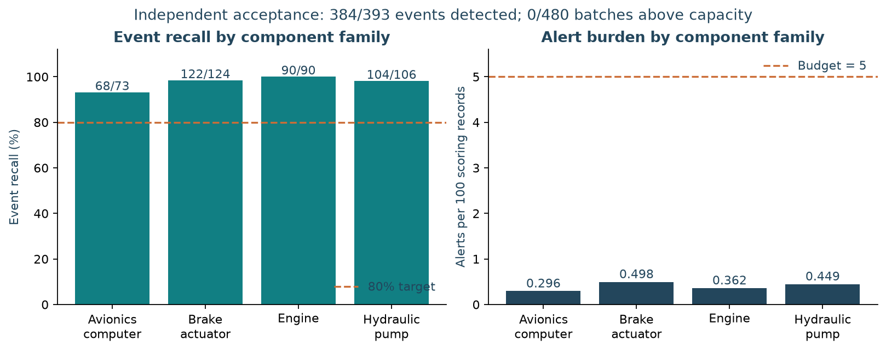
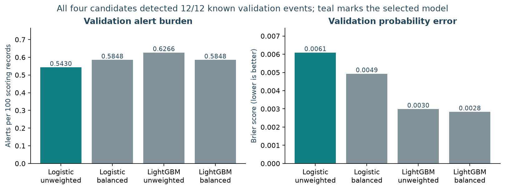
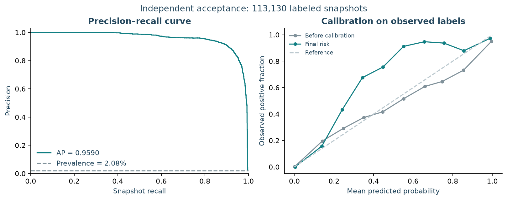
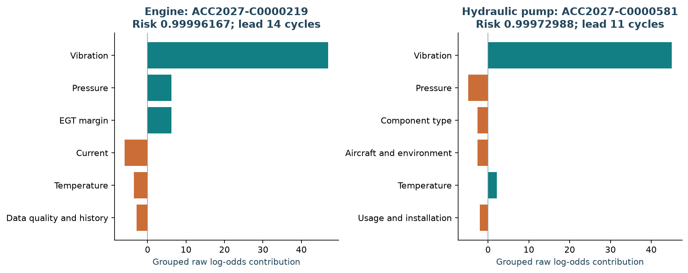

# Aircraft MRO Unscheduled Removal Prediction

Predict whether an in-service aircraft component will undergo an **unscheduled removal within the next 30 flight cycles**. The project includes data generation, features with availability controls, model comparison, calibrated risk, alert capacity limits and maintenance explanations.

**[Read the illustrated submission report](reports/final_report.md)** · [Executed Notebook](notebooks/independent_acceptance_2027.ipynb) · [Requirements checklist](docs/submission-checklist.md)

## Independent acceptance results

The frozen unweighted logistic model passed acceptance on a new simulated fleet spanning **2027–2031**. Model selection and the data generation protocol were frozen before that fleet was generated.

| Metric | Result | Criterion |
| --- | ---: | ---: |
| Event recall | **97.71% — 384/393 events** | ≥80% |
| Alerts per 100 component scoring records | **0.4008 — 461 alerts** | ≤5 |
| Batches above capacity | **0/480** | 0 |
| Median first alert lead | **7 cycles** | Descriptive |
| Group bootstrap recall interval | **96.27%–98.97%** | 95% interval, 1,000 draws |



Acceptance covers 60 aircraft, 712 installations and 115,016 scoring records. Nine events were missed; 77 alerts have censored or pending outcomes and count toward alert burden. Aircraft, component, installation, snapshot and event identifiers have zero overlap with the prior data.

## Submission materials

The [main report](reports/final_report.md) follows the five requested outputs and includes methods, results, design decisions and limitations.

| Requested output | Report content |
| --- | --- |
| Data preparation and modeling | Target, censoring, availability, entity/time splits, preprocessing and four candidates |
| Evaluation and threshold selection | Candidate comparison, validation threshold replay, PR and calibration curves, independent acceptance and intervals |
| Predictions and interpretability examples | Global contributions, two detected components, an avionics miss, risk trajectories and event outcomes |
| Proposed deployment and monitoring | Batch service, versioned package, persistent alert state, inspection queue, monitoring, retraining and rollback |
| Limitations and future improvements | Synthetic mechanisms, calibration and policy sample size, lead time, competing risks and component transfers |

The report embeds **seven result figures**. The [submission checklist](docs/submission-checklist.md) maps each requirement to its section and supporting files.

## Model comparison and result figures

Four candidates use the same partitions and alert policy. All detected 12 known validation events. Selection prioritizes event recall and lower alert burden; **unweighted logistic regression** achieved the lowest burden. LightGBM achieved lower Brier scores.



The frozen risk threshold is **0.9995918400998122**, with **30-cycle duplicate suppression** and **floor(0.05 × batch size)** capacity. Policy selection uses labels available before 2025-09-01; records with unavailable outcomes remain in the scoring population.



The selected model's explanations sum transformed-feature contributions within operational groups. The intercept plus all grouped contributions reconstructs the saved raw log-odds. Calibrated risk is displayed separately.



The [main report](reports/final_report.md) also shows the validation threshold curve, global contributions and detected/missed trajectories, together with the proposed deployment and monitoring scheme.

## Reproduce

Requirements: **Python 3.12** and **uv**. Run from the repository root with a fresh run ID.

```sh
uv sync --locked
uv run python -m src.rebuild_experiment --run-id reproduction_v2
uv run python tools/build_submission_report.py --run-id reproduction_v2 --output reports/reproduction_v2/final_report.md
```

The first command installs locked dependencies. The experiment command runs the 27 tests, prepares data and features, fits and selects candidates, freezes the model/protocol, generates the independent fleet, evaluates it once and writes compact evidence. The final command builds the illustrated report from saved predictions. Threshold sensitivity uses validation predictions.

Full local models, generated tables, features and predictions are written to `artifacts/runs/<run-id>/`; compact results are written to `reports/<run-id>/`. Both directories must be new for a reproduction.

Rebuild the current figures and report from the existing local `corrected_v2` run:

```sh
uv run python tools/build_submission_report.py
```

Run the tests or refresh the delivered Notebook separately:

```sh
uv run pytest -q
uv run jupyter nbconvert --to notebook --execute --inplace notebooks/independent_acceptance_2027.ipynb
```

The development CSV is included as [data/mro_dataset.csv](data/mro_dataset.csv), approximately 48 MB. The [data dictionary](DATASET.md) describes its target and timing rules. The [independent generation configuration](configs/mock_data_acceptance_2027.yaml) and [registered protocol](configs/acceptance_2027.json) define the new simulated fleet.

## Project organization

```text
mro/
├── README.md
├── DATASET.md
├── src/                         # Frozen experiment implementation
├── tests/                       # Unit, integration and regression checks
├── tools/                       # Report and figure generation
├── configs/                     # Development and acceptance configuration
├── data/mro_dataset.csv         # Development dataset
├── reports/
│   ├── final_report.md          # Illustrated submission report
│   ├── figures/                 # Seven current result figures
│   ├── analysis/                # Figure data, cases and provenance
│   └── corrected_v2/            # Saved acceptance evidence
├── notebooks/                   # Current executed acceptance Notebook
├── docs/                        # Checklist, design and review notes
└── archive/v1/                  # Earlier reports, figures and Notebook
```

[Project structure and artifact guide](docs/project-structure.md) documents the local intermediate directories. Old outputs and the original PR/SHAP figures are preserved in the [historical archive](archive/README.md). Generated data, environments, caches and full local experiment artifacts are excluded from Git.

## Evidence and operational scope

- [Acceptance summary and exact metrics](reports/corrected_v2/summary.md)
- [Candidate comparison](reports/corrected_v2/validation_candidate_metrics.csv)
- [Per-event detections and misses](reports/corrected_v2/event_detection.csv)
- [Frozen protocol and model identity](reports/corrected_v2/freeze_manifest.json)
- [Figure inputs and hash manifest](reports/analysis/report_manifest.json)
- [Saved test output](reports/corrected_v2/test_results.txt)

The proposed production service adds a persistent suppression store, an engineer queue, matured-outcome monitoring and release/rollback controls to the implemented offline pipeline and monitoring utilities. Acceptance uses synthetic data under the generator's degradation mechanism. Real fleet validation, earlier inspection lead time and competing-risk outcomes are the next development priorities.
