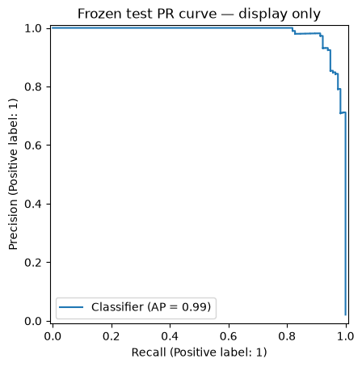
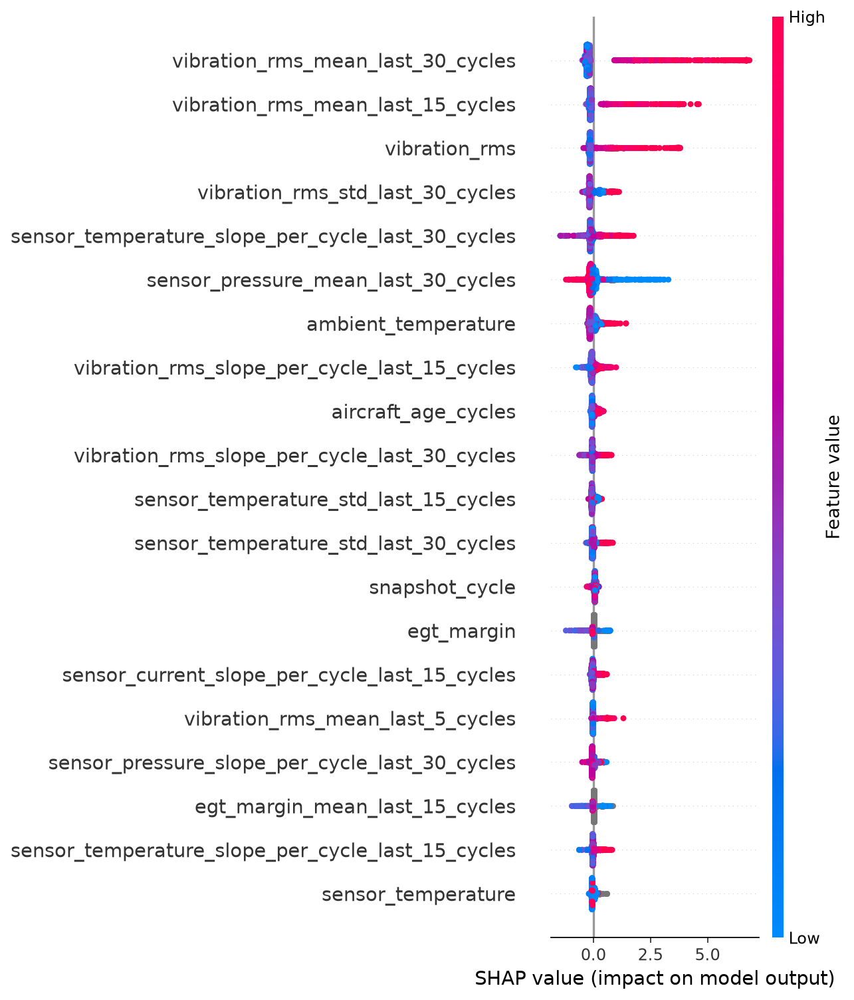

# 历史实验材料

`v1/` 保存可用时间修复前的报告、解释图、预测输出和已执行 Notebook。对应 Git 版本为 [`536f0c1`](https://github.com/wizounovziki/ML-solution-for-aircraft/commit/536f0c1ae173207b870b147a8b06aad3991b83d0)。当前提交报告见 [reports/final_report.md](../reports/final_report.md)。

| 材料 | 位置 |
| --- | --- |
| 旧 Notebook | [poc_evaluation.ipynb](v1/notebooks/poc_evaluation.ipynb) |
| 旧 PR 曲线（从 Notebook 保存输出提取） | [notebook_precision_recall.png](v1/reports/figures/notebook_precision_recall.png) |
| 旧 LightGBM SHAP 汇总图 | [shap_summary.png](v1/reports/figures/shap_summary.png) |
| 旧解释卡与预测结果 | [v1/reports/](v1/reports/) |

## v1 保存的 PR 曲线

## v1 保存的 LightGBM SHAP 汇总图

旧 Notebook 保留原执行输出；其代码中的运行路径反映旧目录结构。当前 Notebook 和复现入口见仓库 README。
