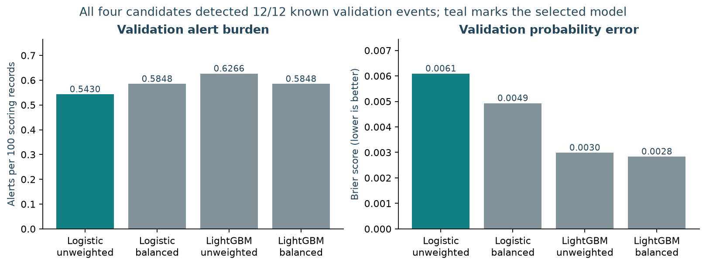
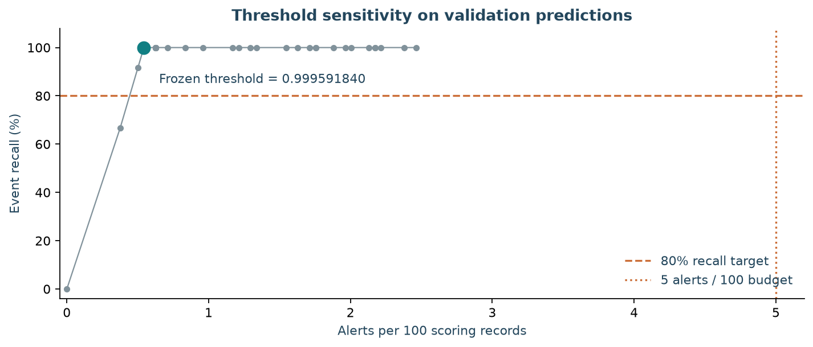
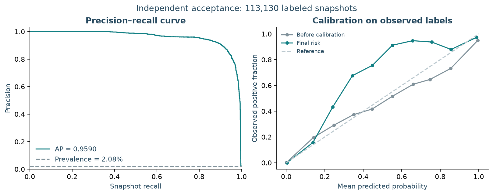
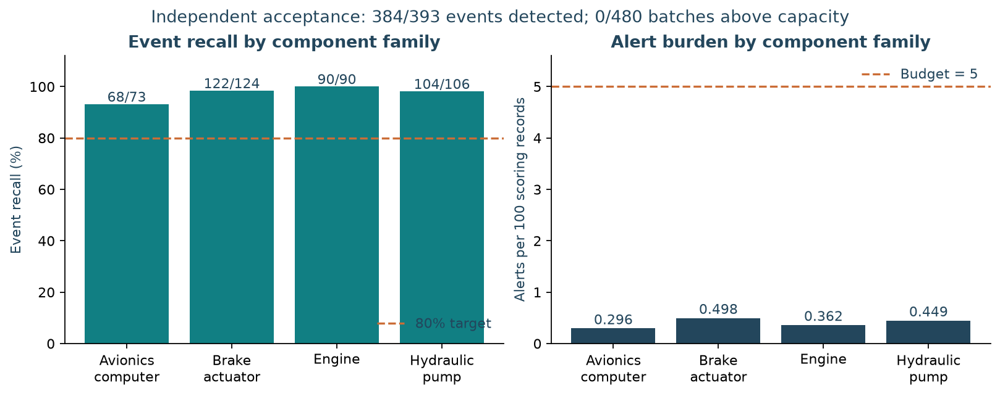
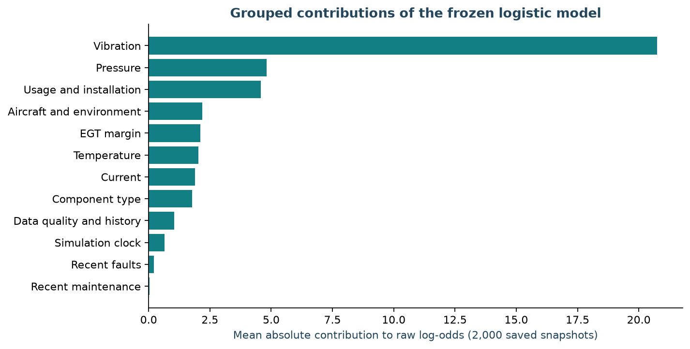
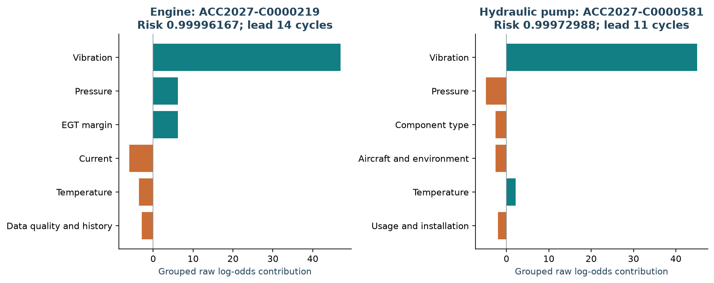
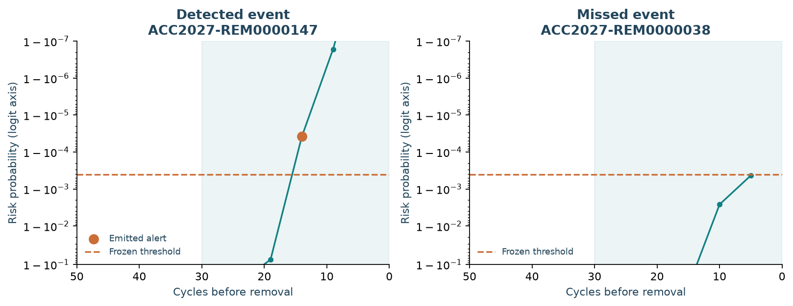
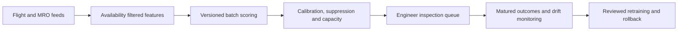

# Aircraft Component Removal Prediction — Submission Report

The frozen unweighted logistic model detected **384/393 events (97.71%)** on an independent simulated fleet, producing **461 alerts across 115,016 scoring records**. All **480 batches** remained within capacity. The acceptance criteria were event recall ≥80%, alerts ≤5 per 100 scoring records overall and per batch, and at least 100 events.

## 1. Data preparation and modeling methods

The task is to identify an unscheduled removal in the next 30 flight cycles for the same component installation. Development data contain 60 aircraft, 723 installations and 114,989 snapshots, with 2.1434% positive labeled snapshots. The generator supplies sensor trajectories, fault and maintenance histories, reporting delays, missing values, outliers and censoring. [Dataset dictionary](../DATASET.md).

Features use both event time and availability time. Current readings unavailable at scoring are masked; they become eligible for later rolling history when they arrive. Means, standard deviations and slopes cover 5/15/30-cycle windows. An allowlist excludes identifiers, labels and future removal metadata. Preprocessing and baseline statistics are fitted on training data.

Aircraft/component connected groups are disjoint across outer development partitions. Training ends before 2024-09-01 (36,252 records, 102 events); separate sigmoid calibration uses 2,002 records and 14 events before 2025-03-01. Policy replay covers 2,394 records before 2025-09-01. Only 2,107 labels and 12 events were available by that freeze cutoff; the other 287 records still count toward alert burden.

Regularized logistic regression uses imputation, missingness indicators, splines, scaling and one-hot encoding. LightGBM supplies a nonlinear tree candidate with native numerical missingness. Weighted and unweighted variants provide four candidates under the same policy replay.

## 2. Model evaluation and threshold selection

| Validation candidate | Event recall | Alerts / 100 | Brier score |
| --- | ---: | ---: | ---: |
| logistic_unweighted | 100% | 0.5430 | 0.006092 |
| logistic_balanced | 100% | 0.5848 | 0.004929 |
| lightgbm_unweighted | 100% | 0.6266 | 0.002989 |
| lightgbm_balanced | 100% | 0.5848 | 0.002835 |

All candidates detected the 12 known validation events. Selection orders event recall, lower alert burden, fewer known false positives, lower Brier score and fitting cost. Unweighted logistic regression won on alert burden. LightGBM achieved better Brier scores, making calibration quality a relevant future comparison.

The frozen threshold is **0.9995918400998122**, with **30-cycle duplicate suppression** and capacity **floor(0.05 × batch size)**. Only emitted alerts update suppression state. Batches below 20 components have zero capacity under this rule.

This sensitivity replay uses saved validation predictions. The marker identifies the already frozen operating point. Independent acceptance predictions retain that threshold and policy.

The model and generator protocol were frozen before acceptance data generation. The new seed is 20261113, with the ACC2027 namespace, 60 aircraft, 712 installations and 115,016 snapshots. Actual simulated dates span **2027-01-04 to 2031-12-06**, after the prior dataset's end on 2026-12-06. Aircraft, components, installations, snapshots and removal identifiers have zero overlap. [Protocol and provenance](corrected_v2/test_metrics.json).

| Independent acceptance metric | Result |
| --- | ---: |
| Event recall | **97.71% (384/393)** |
| Alerts per 100 scoring records | **0.4008 (461 alerts)** |
| Batches above capacity | **0/480** |
| PR-AUC / ROC-AUC | 0.959018 / 0.995877 |
| Brier score | 0.003754 |
| Known outcome precision | 100% (384/384) |
| Censored or pending alerts | 77 |
| Median first alert lead | 7 cycles; range 1–17 |

Ranking and calibration use 113,130 snapshots with observed labels. A component contributes one scoring record per batch. Event recall counts each removal once. The 1,000-draw group bootstrap recall interval is **96.27%–98.97%**, preserving duplicate group weights.

| Component family | Detected / actual events | Recall | Alerts / 100 |
| --- | ---: | ---: | ---: |
| Avionics computer | 68/73 | 93.15% | 0.2955 |
| Brake actuator | 122/124 | 98.39% | 0.4976 |
| Engine | 90/90 | 100.00% | 0.3616 |
| Hydraulic pump | 104/106 | 98.11% | 0.4487 |

## 3. Predictions and interpretability examples

Predictions include snapshot, aircraft and component identifiers; raw log-odds; final risk; suppression and capacity decisions; data quality; reason codes; and model, feature and policy versions. All 461 emitted alerts have reason codes. [Per-event outcomes](corrected_v2/event_detection.csv).

The selected logistic model uses contributions from its transformed features relative to zero. Contributions are summed within operational groups; the model intercept plus all groups reconstructs the saved raw score. These contributions describe the model's raw log-odds. Calibration and cold start blending produce the separate risk probability. EGT channel contributions for non-engine components are grouped under data quality because those channels are structurally unavailable.

| Example | Component / event | Risk | Result |
| --- | --- | ---: | --- |
| Engine alert | ACC2027-C0000219 / ACC2027-REM0000147 | 0.99996167 | Detected 14 cycles before removal |
| Hydraulic pump alert | ACC2027-C0000581 / ACC2027-REM0000384 | 0.99972988 | Detected 11 cycles before removal |
| Avionics miss | ACC2027-C0000056 / ACC2027-REM0000038 | 0.99956758 | Highest risk in the missed event's prediction window remained below threshold |

For engine alerts, engineers can review vibration and EGT trends against sensor and fault records. For hydraulic pump alerts, inspection can focus on vibration, pressure, leakage evidence and related maintenance. Final maintenance action remains with authorized engineers.

Nine events were missed: five avionics, two brake actuator and two hydraulic pump events. All nine had maximum risk below the frozen threshold in their positive windows. The nearest miss reached 0.99956758 against a threshold of 0.99959184. There were zero known false positives; 77 censored or pending alerts are included in burden and excluded from known outcome precision. [Example inputs and grouped contributions](analysis/case_studies.json).

## 4. Proposed deployment and monitoring

The proposed daily batch service consumes flight, sensor, fault, installation and maintenance records. A deployment package holds the fitted preprocessor, model, calibrator, feature schema, threshold and capacity policy. Persisting last emitted alert cycles across runs preserves suppression. Queue records carry risk, reasons, data quality, lead context, inspection status and engineer feedback for AMOS/Maximo integration.

| Monitor | Measure and proposed response |
| --- | --- |
| Inputs | Track feed delay, missingness, unknown categories and out-of-range values; flag affected queue records and use the finite baseline fallback for invalid model scores |
| Predictions | Track score PSI and PSI of important features against the training reference; sustained changes trigger data and model review |
| Alert operations | Track total and per-batch burden, capacity deferrals, suppression and processing latency; enforce the 5% capacity guard at emission |
| Matured outcomes | After the 30-cycle observation window and reporting delay, compute event recall, known precision, Brier score, lead time and family/time slices with event counts and intervals |
| Releases | Fit a challenger on matured labels, validate calibration and alert policy, reserve an independent interval, require release review and keep the previous model and policy for rollback |

The repository implements offline scoring, cold start fallback, missingness handling, PSI and alert replay. The production service, persistent suppression store, live queue and release automation are proposed integration work.

## 5. Limitations and future improvements

1. Acceptance uses a new simulated fleet under the same degradation mechanism. Real fleet validation needs operational histories and actual maintenance interventions.
2. The 12 policy events and 14 calibration events constrain evidence for threshold stability and probability calibration. Add rolling development windows and larger natural-prevalence calibration samples.
3. Median first alert lead is seven cycles and the minimum is one. Evaluate inspection scheduling and compare policies that value earlier detection using development data.
4. Scheduled removals are competing events; 77 emitted alerts have censored or pending outcomes. Follow matured outcomes and evaluate competing-risk targets for operational data.
5. Explicit component transfers and positive events for new part numbers need additional scenarios. Future model changes require a new independent acceptance interval.

The [executed Notebook](../notebooks/independent_acceptance_2027.ipynb) and [evidence directory](corrected_v2) provide the saved experiment outputs. The [submission checklist](../docs/submission-checklist.md) maps the requested outputs to report sections and files.
